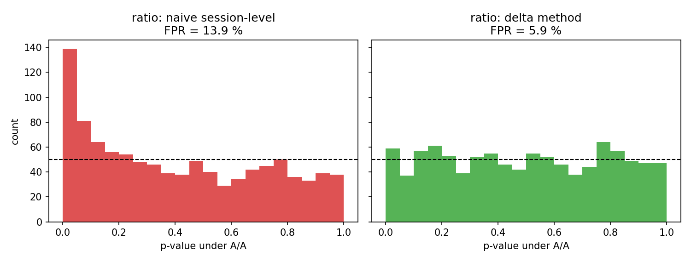
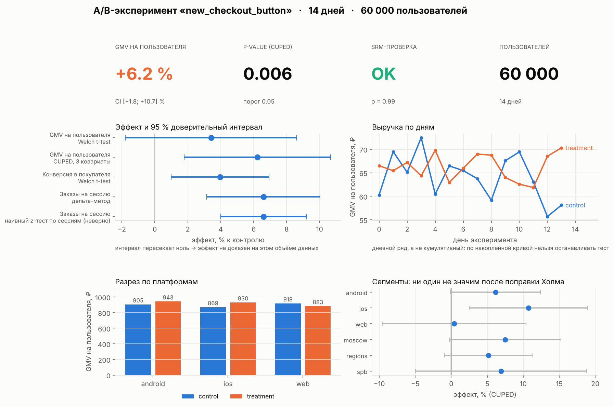

# A/B Testing Lab: CUPED, дельта-метод, бутстрэп и проверка методов на A/A-тестах

Мини-платформа анализа экспериментов для маркетплейса: агентная симуляция пользователей →
SQL-хранилище событий → SQL-витрина метрик → статистические тесты → Monte Carlo-валидация
методов на данных с известной истиной.

## Результаты

**Monte Carlo: 1000 A/A + 1000 A/B экспериментов по 40 000 пользователей** (`results/validation.md`)

| метод | FPR на A/A, % (норма 5 ± 1.4) | мощность при +8 % к конверсии, % |
|---|---|---|
| GMV на пользователя: t-test Уэлча | 6.0 | 66.6 |
| GMV: CUPED (ковариата — GMV до эксперимента) | 6.4 | 76.9 |
| **GMV: CUPED, 3 ковариаты (regression adjustment)** | 5.9 | **78.5** |
| GMV: Пуассоновский бутстрэп (150 прогонов) | 6.7 | 68.0 |
| GMV: Манна–Уитни | 6.3 | 79.6 * |
| заказы/сессии: наивный z-тест по сессиям | **13.9** ❌ | 98.5 |
| **заказы/сессии: дельта-метод** | 5.9 ✅ | 95.5 |

* CUPED с тремя ковариатами снижает дисперсию на **27 %**: та же мощность на 27 % меньшей выборке
  (или на 27 % более коротком эксперименте). Мощность 67 % → 78 %.
* Наивный тест для ratio-метрики ошибается в **2.8 раза чаще** заявленных 5 %; дельта-метод
  откалиброван.
* \* Манна–Уитни «мощнее», но проверяет другую гипотезу (стохастическое доминирование, а не разность
  средних). Решение по выручке на нём принимать нельзя.



**Дашборд** (`notebooks/ab_experiment_analysis.ipynb`, раздел 8). Витрины выгружаются
в `data/marts/*.csv`; как собрать из них дашборд в Yandex DataLens — в
[`docs/datalens.md`](docs/datalens.md).



**Кейс одного эксперимента** (`results/case_study.md`): 60 000 пользователей, истинный эффект +8 %.
Обычный t-test не увидел эффект (p = 0.20): в контроль случайно попали более «денежные» пользователи.
CUPED скорректировал этот дисбаланс по предпериоду и дал +6.2 % [+1.8; +10.7], p = 0.006.

## Интуиция и формулы

**CUPED — это метод контрольных переменных из Монте-Карло.** Выручка пользователя = «сигнал»
(эффект эксперимента) + большой «фон» (насколько он богатый и активный). Фон виден заранее, по
предпериоду. Вычитаем предсказанный фон: `y' = y − θ(x − E x)`, `θ = Cov(y, x)/Var(x)`.
`x` измерен до рандомизации, поэтому несмещённость сохраняется, а `Var(y') = Var(y)(1 − ρ²)`.
С несколькими ковариатами это проекция `y` на их линейную оболочку, и дисперсия падает на `R²`.

**Дельта-метод — это формула распространения ошибок из физпрака.** Для `R = mean(N)/mean(D)`
линеаризация первого порядка даёт
`Var R ≈ (Var N − 2R·Cov(N, D) + R²·Var D) / (n·μ_D²)`.
Ключевое — единица рандомизации. Рандомизируем пользователей, значит независимы пары `(N_u, D_u)`,
а не отдельные сессии.

**Почему наивный тест врёт.** Сессии одного пользователя имеют общую склонность к покупке `p_u`
и положительно скоррелированы. Наивный тест считает их независимыми и завышает эффективный размер
выборки (design effect). Доверительный интервал выходит слишком узким, ложных срабатываний
становится больше. Ровно та же ошибка — считать автокоррелированные измерения независимыми.

## Что внутри

```
notebooks/ab_experiment_analysis.ipynb   весь разбор с сохранёнными выводами: SQL -> SRM -> MDE ->
                          эффекты -> сегменты -> A/A-проверка -> витрины -> дашборд
sql/user_metrics.sql      CTE + LEFT JOIN + CASE: метрики на пользователя (эксперимент и предпериод)
sql/mart_daily.sql        аддитивная витрина для BI: день x вариант x платформа, оконная функция
sql/srm.sql               проверка Sample Ratio Mismatch
sql/daily_gmv.sql         оконные функции: кумулятивная выручка по дням
src/ablab/population.py   генеративная модель: Gamma-активность, Beta-конверсия, LogNormal-чек;
                          hash-сплит пользователей как на реальных платформах
src/ablab/db.py           событийное SQLite-хранилище (users, assignments, sessions, orders)
src/ablab/stats.py        Welch, CUPED, regression adjustment, дельта-метод, Poisson bootstrap,
                          Mann-Whitney, SRM, MDE и размер выборки
scripts/run_case_study.py дизайн (MDE) -> SRM -> метрики -> CUPED -> сегменты с поправкой Холма
scripts/run_validation.py Monte Carlo: калибровка FPR и мощность всех методов
docs/datalens.md          как собрать дашборд в Yandex DataLens поверх витрин
tests/                    дельта-метод ~ бутстрэп, несмещённость CUPED, SRM, обратимость MDE
```

## Запуск

```bash
pip install -r requirements.txt
jupyter notebook notebooks/ab_experiment_analysis.ipynb   # разбор целиком, ~3 мин
python scripts/run_case_study.py     # ~30 c, создаёт data/warehouse.sqlite (~40 МБ, в git не идёт)
python scripts/run_validation.py     # ~2.5 мин; быстрый прогон: --runs 200
pytest -q
```

Ноутбук сохранён с выводами ячеек, поэтому читается без запуска.

## Ограничения и что дальше

* Данные синтетические, зато с известной истиной: только так можно измерить FPR и мощность.
  Следующий шаг — прогнать тот же пайплайн на открытом датасете эксперимента.
* Нет последовательного тестирования. Подглядывание (peeking) завышает FPR, и честное решение —
  mSPRT или group sequential design.
* Сетевых эффектов между пользователями нет. На маркетплейсе покупатели конкурируют за товар,
  и для таких метрик нужны switchback- или кластерные эксперименты.
